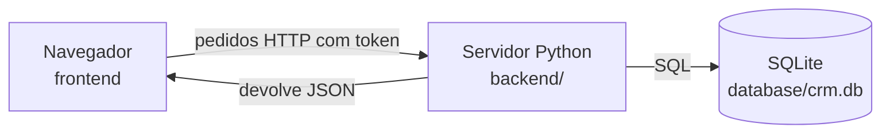
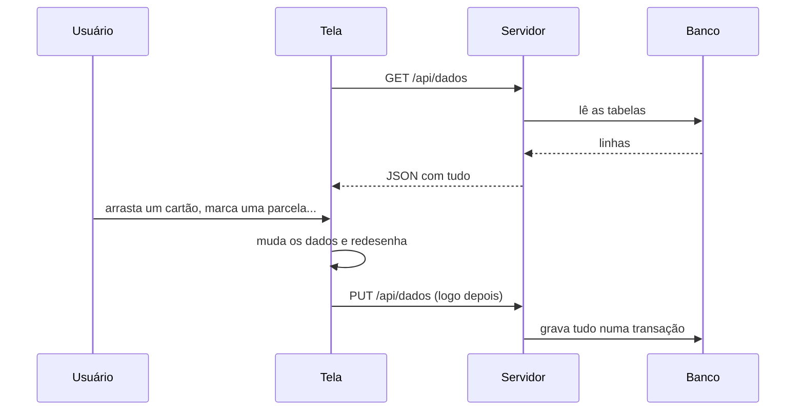
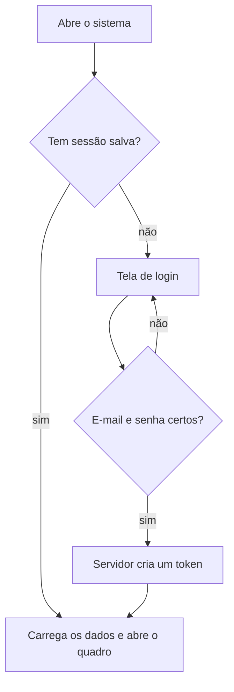
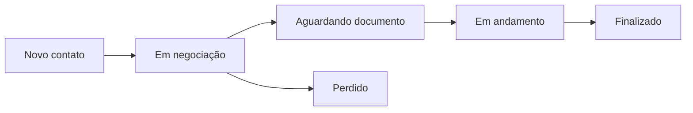
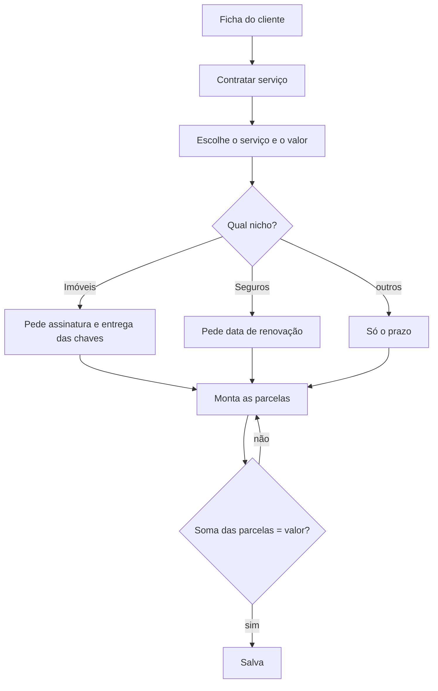
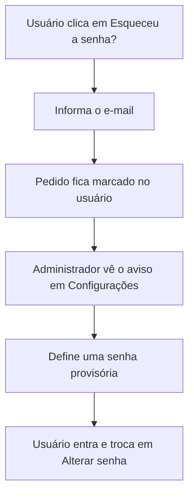
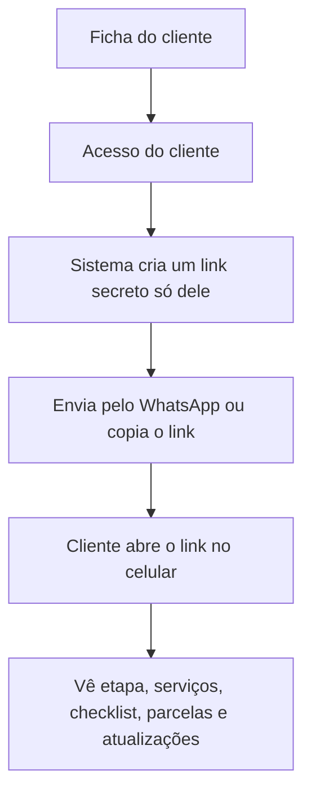
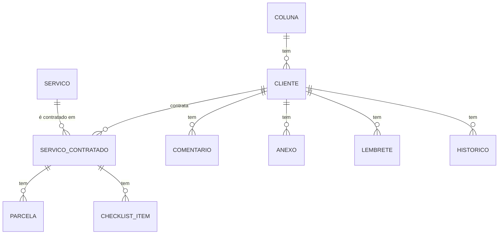

# WS Gestão

Sistema web feito para o trabalho de Engenharia de Software. A cliente é a Wilma Silva Soares, de Teresina (PI), que trabalha com assessoria comercial, compra e venda de imóveis, despachante documentalista e seguros.

Antes, ela controlava tudo no WhatsApp, no caderno e na memória. O sistema junta isso num lugar só: cada cliente vira um cartão num quadro, separado pela etapa em que está, e dentro do cartão ficam os serviços que ele contratou, quanto vai pagar, as parcelas, os prazos e os documentos.

Equipe: Arthur de Holanda, Davi Silva Soares, Luis Felipe e Saulo Pietro.

## Sumário

1. [Como rodar](#como-rodar)
2. [Como o sistema é montado](#como-o-sistema-é-montado)
3. [Telas](#telas)
4. [Fluxos principais](#fluxos-principais)
5. [Regras de negócio](#regras-de-negócio)
6. [Banco de dados](#banco-de-dados)
7. [API](#api)
8. [Backup automático](#backup-automático)
9. [Hospedagem](#hospedagem)
10. [O que ficou de fora](#o-que-ficou-de-fora)

## Como rodar

Precisa do Python 3.9 ou mais novo. Não tem nada para instalar além dele.

No Windows, é só dar dois cliques no `iniciar.bat`. Ele confere se o Python está instalado, liga o servidor e abre o navegador.

Em qualquer sistema, pelo terminal, dentro da pasta do projeto:

```
python backend/app.py
```

Depois abra http://localhost:8770. Na primeira vez o banco `database/crm.db` é criado sozinho, já com alguns clientes de exemplo para dar para testar.

Usuários de teste:

| Perfil        | E-mail             | Senha    |
|---------------|--------------------|----------|
| Administrador | admin@crm.com      | admin123 |
| Assistente    | assistente@crm.com | 123456   |

Para usar de verdade, troque essas senhas logo no primeiro acesso.

Também dá para abrir o `frontend/index.html` direto no navegador, sem o servidor. Nesse caso o sistema funciona do mesmo jeito, mas os dados ficam guardados só naquele navegador (no `localStorage`), e não no banco.

## Como o sistema é montado

São três partes: a tela, o servidor e o banco.



- **Frontend:** HTML, CSS e JavaScript puros, sem framework. É o que aparece na tela.
- **Backend:** um servidor em Python que usa só a biblioteca padrão. Ele entrega os arquivos da tela e responde a API.
- **Banco:** SQLite, que é um banco num arquivo só. As tabelas estão em `database/schema.sql`.

### Pastas e arquivos

```
ws-gestao/
├── backend/                  servidor em Python
│   ├── app.py                ponto de entrada no computador: cria o banco e liga o servidor
│   ├── wsgi.py               ponto de entrada na hospedagem
│   ├── api.py                regras de cada rota da API
│   ├── routes.py             servidor local: entrega a tela e repassa /api/ para o api.py
│   ├── database.py           tabelas, leitura, gravação, sessões, portal e backup
│   ├── auth.py               hash das senhas (PBKDF2)
│   ├── backup.py             faz um backup na hora (para agendar)
│   └── config.py             caminhos dos arquivos, porta e quantos backups guardar
│
├── database/
│   ├── schema.sql            criação das tabelas
│   ├── crm.db                o banco (criado na 1ª execução, não vai para o Git)
│   ├── anexos/               os arquivos anexados nas fichas (fora do Git)
│   └── backups/              um backup por dia (também fora do Git)
│
├── frontend/                 tudo o que roda no navegador
│   ├── index.html            o sistema (para a equipe)
│   ├── portal.html           a página de acompanhamento do cliente
│   └── assets/
│       ├── css/
│       │   ├── style.css     todo o visual
│       │   └── portal.css    ajustes da página do cliente
│       └── js/
│           ├── core/         base usada por todo o resto
│           │   ├── dados.js      constantes e dados de exemplo
│           │   ├── estado.js     estado da tela, sessão e chamadas à API
│           │   ├── icones.js     ícones SVG
│           │   └── utils.js      formatação, validação de CPF/CNPJ e lembretes
│           ├── components/   peças reaproveitadas
│           │   ├── modal.js      janelas e confirmações
│           │   └── sino.js       sino de lembretes
│           ├── auth/
│           │   └── login.js      login, esqueci a senha e troca de senha
│           ├── pages/        uma por tela
│           │   ├── quadro.js         quadro de vendas, lista e calendário
│           │   ├── clientes.js       lista de clientes
│           │   ├── ficha-cliente.js  ficha, serviços contratados e parcelas
│           │   ├── servicos.js       catálogo de serviços
│           │   ├── financeiro.js     pagamentos e relatórios
│           │   ├── agenda.js         tarefas e compromissos
│           │   ├── configuracoes.js  usuários, empresa e backup
│           │   └── documentos.js     proposta, contrato, WhatsApp e e-mail
│           ├── main.js       liga o sistema quando a página abre
│           └── portal.js     monta a página do cliente
│
├── iniciar.bat               atalho para abrir no Windows
└── README.md
```

O `index.html` carrega os scripts nesta ordem: primeiro `core`, depois `components` e `auth`, depois as `pages` e por último o `main.js`. A ordem importa, porque cada arquivo usa funções dos que vieram antes.

No backend, cada arquivo cuida de uma coisa só. As regras da API ficam todas no `api.py`, e quem recebe os pedidos é o `routes.py` (no computador) ou o `wsgi.py` (na hospedagem). Assim o mesmo código roda nos dois lugares. O `api.py` usa o `database.py` para ler e gravar e o `auth.py` para conferir senhas. As sessões de login ficam gravadas no banco, então ninguém é deslogado quando o servidor reinicia.

### Como os dados andam

Quando a página abre, ela pede todos os dados ao servidor de uma vez e guarda na memória. Tudo o que a pessoa faz na tela muda esses dados na memória e a tela é desenhada de novo. Logo depois, a página manda os dados de volta para o servidor, que grava tudo no banco de uma vez só (numa transação, então ou grava tudo ou não grava nada).



## Telas

O menu fica no topo e tem cinco partes. Algumas têm sub-abas.

| Menu             | O que tem dentro |
|------------------|------------------|
| Quadro de vendas | O quadro com os clientes por etapa. Dá para ver como quadro, lista ou calendário, e filtrar por nicho. |
| Clientes         | A lista de todos os clientes, inclusive os inativos, com filtros por situação, origem e serviço. |
| Agenda           | **Tarefas:** checklists e lembretes de todos os clientes. **Compromissos:** prazos, parcelas, renovações, assinaturas e entrega de chaves, por data. |
| Financeiro       | **Pagamentos:** todas as parcelas, para marcar como recebidas. **Relatórios:** números do negócio (só o administrador vê). |
| Configurações    | **Serviços:** o catálogo de serviços. **Usuários e empresa:** acessos, dados da empresa e backup (só o administrador vê). |

No topo também ficam a busca, o sino de lembretes, o botão de novo cliente e o menu do usuário, com "Alterar senha" e "Sair".

Clicando num cartão abre a **ficha do cliente**, com três abas:

- **Serviços:** os serviços contratados, com valor, situação, datas, checklist e parcelas;
- **Atividade:** comentários, lembretes e o histórico do que mudou;
- **Arquivos:** os anexos (documentos, fotos, contratos assinados), de até **20 MB** cada.

Atalhos de teclado: `N` abre um novo cliente, `/` vai para a busca e `Esc` fecha a janela aberta.

## Fluxos principais

### Entrar no sistema



Se marcar "Manter conectado", a sessão continua mesmo fechando o navegador. Sem marcar, ela acaba quando o navegador fecha. A sessão vale 30 dias e fica gravada no banco, então reiniciar o servidor não desloga ninguém.

### Atender um cliente do começo ao fim

Esse é o caminho normal de um cliente pelo quadro.



1. **Cadastro.** O cliente chama no WhatsApp ou no Instagram. Clique em "Novo cliente" e preencha o nome e pelo menos um contato. Ele entra na coluna "Novo contato".
2. **Negociação.** Arraste o cartão para "Em negociação". Na ficha, use "Contratar serviço" para registrar o que ele quer, o valor combinado e as parcelas. Gere a proposta em PDF e mande pelo WhatsApp ou por e-mail.
3. **Documentos.** Se ele aceitou mas falta mandar documento, arraste para "Aguardando documento". Use o checklist do serviço para marcar o que já chegou.
4. **Execução.** Com tudo em mãos, arraste para "Em andamento". Gere o contrato, acompanhe os prazos na Agenda e marque as parcelas conforme ele for pagando.
5. **Fim.** Quando acabar, marque o serviço como finalizado e arraste o cartão para "Finalizado". Se ele desistir em qualquer momento, vai para "Perdido".

Toda vez que o cartão muda de coluna, isso fica salvo no histórico da ficha, com quem mudou e quando.

### Contratar um serviço



As parcelas podem ser feitas à mão ou com "Dividir automaticamente", que cria parcelas de 30 em 30 dias.

### Receber um pagamento

1. Abra **Financeiro → Pagamentos**, ou a ficha do cliente.
2. Clique em **Receber** na parcela. Ela fica como paga, com a data de hoje.
3. Se clicou errado, **Desfazer** volta ela para pendente.

Parcela que passou do vencimento sem ser paga fica em vermelho como **Atrasada** e aparece no sino.

### Esqueci a senha



A mensagem que aparece depois de pedir é sempre a mesma, existindo ou não aquele e-mail. Assim ninguém consegue descobrir quem tem conta.

Se quem esqueceu foi o próprio administrador, rode `python backend/app.py --resetar-admin` e a senha do `admin@crm.com` volta a ser `admin123`.

### Portal do cliente

O cliente pode acompanhar o andamento sem precisar ligar ou mandar mensagem perguntando.



1. Na ficha do cliente, clique em **Acesso do cliente**. O sistema cria um link do tipo `.../portal#código`.
2. Mande o link pelo botão **Enviar no WhatsApp** ou copie e mande como preferir. O cliente não precisa de senha.
3. Ao abrir, ele vê:
   - em que etapa está (a coluna do quadro);
   - cada serviço contratado, se está em andamento ou concluído, e as datas (prazo, assinatura, chaves, renovação);
   - o checklist de cada serviço, com uma barra de progresso;
   - as parcelas, com o que está pago, a pagar ou atrasado;
   - as atualizações que a equipe marcou para ele ver.
4. Na aba **Atividade** da ficha, ao escrever um comentário, marque **Mostrar esta atualização para o cliente**. Sem marcar, o comentário fica só para a equipe.
5. Para cortar o acesso, use **Desativar link**. Se precisar, depois é só gerar outro, que será diferente do antigo.

O código do link tem 36 caracteres aleatórios, então não dá para adivinhar. Cliente inativo perde o acesso automaticamente.

### Lembretes

O sino não precisa de cadastro: ele olha os dados toda vez que a tela atualiza e mostra o que está perto de vencer.

| Aviso                 | Quando aparece |
|-----------------------|----------------|
| Prazo de serviço      | serviço em andamento com prazo nos próximos 7 dias ou já vencido |
| Renovação de seguro   | dentro da antecedência configurada (30 dias, se ninguém mudar) |
| Parcela               | pendente e vencendo nos próximos 5 dias ou já vencida |
| Tarefa ou lembrete    | não concluído, para os próximos 3 dias ou já passado |

Cliente inativo não gera aviso.

## Regras de negócio

Estas regras saíram da entrevista e da validação com a cliente (capítulos 4 e 8 da documentação). Ao lado de cada uma está onde o sistema confere.

### Clientes

- **RN01:** todo cliente tem nome e pelo menos um contato, telefone ou e-mail. *Conferido na tela e no banco.*
- **RN02:** o cliente é pessoa física ou jurídica. O CPF/CNPJ é opcional, mas se for preenchido os dígitos verificadores precisam estar certos. Números repetidos, como 111.111.111-11, são recusados. *Conferido na tela.*
- **RN10:** a origem é opcional (Instagram, indicação ou outra). Se for indicação, aparece o campo "Quem indicou". *Na tela.*
- **RN13:** cliente não é excluído, só inativado. O inativo some do quadro, da agenda e dos lembretes, mas continua na lista de clientes e nos relatórios, e pode ser reativado. *Na tela: não existe botão de excluir.*
- **RN16 (atualizada):** o cliente não entra no sistema da equipe, mas pode acompanhar o próprio atendimento por um link só dele (veja [Portal do cliente](#portal-do-cliente)). Ele só vê os dados dele e nada pode alterar. *No servidor.*

### Serviços

- **RN03:** um cliente pode contratar vários serviços, e cada contratação tem seu próprio valor.
- **RN04:** o catálogo não tem preço. O valor é combinado na hora de contratar e tem que ser maior que zero. *Na tela e no banco.*
- **RN05:** todo serviço pertence a um dos quatro nichos. *No banco.*
- **RN07:** cada serviço contratado está "em andamento" ou "finalizado". Só os em andamento entram na proposta e nos avisos de prazo. *No banco.*
- **RN08:** em compra e venda de imóveis, registra a data de assinatura do contrato e a de entrega das chaves.
- **RN09:** em seguros, registra a data de renovação e avisa antes. A antecedência muda em Configurações.
- Serviço com parcela já paga não pode ser removido, só finalizado.

### Parcelas

- **RN11:** as parcelas precisam somar exatamente o valor combinado. Também pode não ter parcela, para pagamento à vista. *Na tela.*
- **RN12:** parcela vencida e não paga fica marcada como atrasada e aparece no sino.
- O faturamento do mês conta só o que foi pago, pela data em que foi pago.

### Quadro

- **RN06:** cada cliente fica em uma coluna só por vez.
- **RN14:** coluna só pode ser arquivada se estiver vazia, e o quadro precisa ter pelo menos uma coluna.
- As colunas podem ser renomeadas, trocadas de lugar e criadas.

### Usuários

- **RN15:** o administrador cuida dos usuários e vê os relatórios. O assistente trabalha com o quadro, os clientes, os serviços e a agenda. *O menu esconde, e o servidor também bloqueia, com erro 403.*
- Senha com no mínimo 6 caracteres. O e-mail não pode se repetir.
- Ninguém consegue inativar o próprio usuário, e usuário inativo não entra.

### Documentos

- **Proposta:** lista os serviços em andamento, com valores, prazos e parcelas, e vale por 15 dias.
- **Contrato:** um por serviço, com objeto, valor e pagamento, prazos, obrigações, dados pessoais (LGPD) e foro.
- Os dois abrem numa janela pronta para imprimir ou salvar em PDF. Os dados da empresa vêm de Configurações.

## Backup automático

Enquanto o servidor estiver ligado, ele faz **um backup por dia** do banco em `database/backups/crm-AAAA-MM-DD.db` e guarda os **últimos 30**. Os anexos também são copiados para `database/backups/anexos/`. A cópia é feita pelo próprio SQLite, então é segura mesmo com alguém usando o sistema na hora.

- Para fazer um backup na hora: `python backend/backup.py`.
- Para restaurar: desligue o servidor, troque o `database/crm.db` por um dos arquivos de `backups/` (renomeando para `crm.db`) e ligue de novo.
- Na hospedagem, o `backup.py` também fica agendado para rodar todo dia (veja [Hospedagem](#hospedagem)).
- O backup manual em JSON, em Configurações, continua existindo.

## Banco de dados

Os anexos não ficam dentro do banco: cada arquivo é salvo em `database/anexos/` e o banco guarda só o nome e a ligação com o cliente. Assim o banco continua pequeno e rápido. O limite de cada arquivo (20 MB) fica em `backend/config.py`. Sem o servidor, no modo local, o limite é de 1 MB, porque o arquivo fica guardado no navegador.

O banco segue o modelo entidade-relacionamento do capítulo 6 da documentação.



Ainda tem a tabela `usuario`, para quem acessa o sistema, e a `configuracao`, para os dados da empresa e a antecedência dos avisos.

As senhas não ficam guardadas: fica só um código gerado a partir delas (PBKDF2 com salt), que não dá para desfazer.

Para fazer cópia de segurança, use **Configurações → Usuários e empresa → Exportar backup**, que baixa um arquivo JSON. O mesmo lugar tem o "Importar" para restaurar. Outro jeito é copiar o arquivo `database/crm.db` com o servidor desligado.

## API

Todas as rotas, menos login, esqueci a senha, portal e ping, precisam do token no cabeçalho `Authorization: Bearer <token>`.

| Método | Rota                  | O que faz |
|--------|-----------------------|-----------|
| GET    | `/api/ping`           | diz se o servidor está no ar |
| POST   | `/api/login`          | confere e-mail e senha e devolve o token |
| POST   | `/api/logout`         | encerra a sessão |
| GET    | `/api/dados`          | devolve todos os dados |
| POST   | `/api/anexos?nome=...`| envia um arquivo (até 20 MB) |
| GET    | `/api/anexos/<id>`    | baixa um arquivo (aceita o token em `?t=`) |
| GET    | `/api/portal/<código>`| o que o cliente vê no portal (não precisa de login) |
| PUT    | `/api/dados`          | grava todos os dados numa transação |
| POST   | `/api/usuarios`       | cria usuário (só administrador) |
| POST   | `/api/esqueci`        | registra o pedido de nova senha |
| POST   | `/api/senha`          | o usuário troca a própria senha |
| POST   | `/api/usuarios/senha` | o administrador define a senha de alguém |

## Hospedagem

O sistema está pronto para rodar na internet em qualquer serviço que aceite Python com WSGI. O passo a passo abaixo é para o **PythonAnywhere**, que tem plano gratuito, guarda o banco SQLite em disco e permite agendar o backup.

1. Crie uma conta em pythonanywhere.com (plano *Beginner*, gratuito).
2. Abra um console **Bash** e baixe o projeto:
   ```
   git clone https://github.com/ddecry/ws-gestao.git
   ```
3. Em **Web → Add a new web app**, escolha *Manual configuration* e a versão mais nova do Python.
4. No arquivo WSGI que o site mostra, apague tudo e deixe só:
   ```python
   import sys
   sys.path.insert(0, "/home/SEU_USUARIO/ws-gestao/backend")
   from wsgi import application
   ```
5. Ative **Force HTTPS** na mesma página e clique em **Reload**. O sistema fica em `https://SEU_USUARIO.pythonanywhere.com`.
6. Em **Tasks**, agende todo dia o comando:
   ```
   python3 /home/SEU_USUARIO/ws-gestao/backend/backup.py
   ```
7. Entre com `admin@crm.com` / `admin123` e **troque a senha na hora**.

Para atualizar depois de mudar o código: `git pull` no console e **Reload** na aba Web.

## O que ficou de fora

Por ser um trabalho da faculdade, algumas coisas do levantamento não entraram:

- envio automático de e-mail e WhatsApp (o sistema abre o WhatsApp ou o e-mail com a mensagem pronta, mas quem envia é a pessoa);
- cobrança automática;
- o cliente receber aviso automático quando algo muda (hoje ele vê ao abrir o link).
